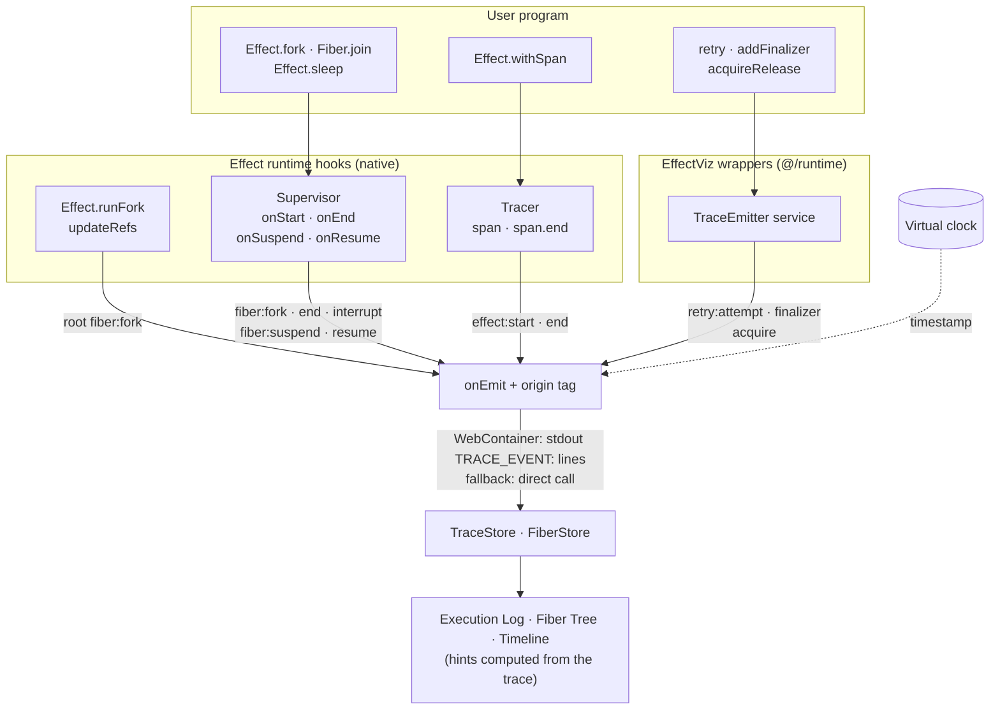

# Where trace events come from

Nearly every row in the Execution Log is reported by Effect's own runtime, through the hooks it provides for observability. The user's program is never rewritten. The runner provides these hooks as layers around `rootEffect`, so the same program would run unchanged without the visualizer.

## The four sources

| Events                                                      | Source                                                                                     | Native to Effect?                                                 |
| ----------------------------------------------------------- | ------------------------------------------------------------------------------------------ | ----------------------------------------------------------------- |
| `fiber:fork`, `fiber:end`, `fiber:interrupt`, `fiber:suspend`, `fiber:resume` | A `Supervisor` added with `Supervisor.addSupervisor` ([`vizSupervisor.ts`](../src/runtime/vizSupervisor.ts)) | Yes: the runtime calls these hooks on every fiber          |
| `effect:start`, `effect:end`                                | A custom `Tracer` set with `Layer.setTracer` ([`vizTracer.ts`](../src/runtime/vizTracer.ts)) | Yes: each `Effect.withSpan` opens and ends a span          |
| The root's `fiber:fork`                                     | The `updateRefs` option of `Effect.runFork` ([`runProgram.ts`](../src/runtime/runProgram.ts)) | Yes, but indirectly: the Supervisor cannot see the root, which exists before it is installed |
| `retry:attempt`, `finalizer`, `acquire`                     | Thin wrappers exported from `@/runtime` ([`tracedRunner.ts`](../src/runtime/tracedRunner.ts)) | No: they delegate to Effect's API and emit through the `TraceEmitter` service, because Effect has no hook for "an attempt failed" or "this finalizer is running" |

## What the visualizer adds

- **Filtering.** The Supervisor sees every fiber, including the runtime's own: cleanup fibers with an empty context and fibers that build layers. Those are dropped, which is why fiber numbers skip: the root is `#0` and the program's first fork is often `#7`. Fibers forked by `Effect.race` or `Effect.all` inherit their caller's context and cannot be told apart from the program's, so they stay visible.
- **Virtual timestamps.** Every event is stamped on the virtual clock that slow mode and the stepper control, not on `Date.now()`, so a trace spans the same duration at any speed.
- **Origin.** Starting a run paused injects an `Effect.yieldNow()` before the program, which produces one `fiber:suspend` / `fiber:resume` pair that the program never wrote. That pair is tagged `origin: "tool"` and the log can hide it ([`traceOrigin.ts`](../src/runtime/traceOrigin.ts)).
- **Hints.** The one-line explanations in the log are not emitted by anything. The UI computes them afterwards by matching patterns in the full trace ([`traceHints.ts`](../src/lib/traceHints.ts)).

## Two run paths, one event stream

Both paths install the same layers and call the same `onEmit`. In a WebContainer the program runs in a separate Node process, so each event is written to stdout as a `TRACE_EVENT:` line and parsed by the page ([`spawnAndParse.ts`](../src/effects/spawnAndParse.ts)). In the in-browser fallback, used on phones and in Safari, `onEmit` writes to the stores directly ([`useEventHandlers.ts`](../src/hooks/useEventHandlers.ts)).

Fiber numbers are the runtime's own `FiberId`s, so they differ between the two paths. Each WebContainer run is a fresh process and its root is always `#0`. The fallback runs in the page, whose own Effect code has already created fibers, so numbering carries on from there.
